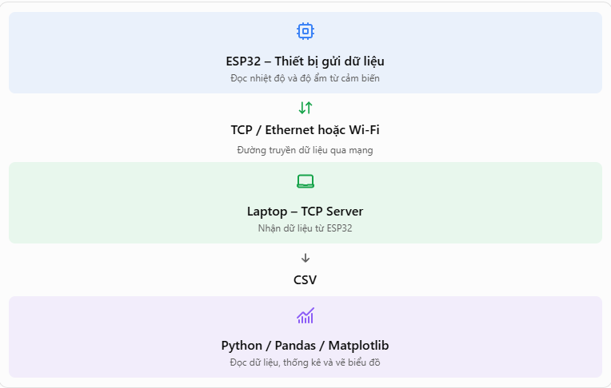

# Xử lý data từ ESP32 thông qua giao thức TCP

## 1. Bài toán đặt ra
- Bạn đang có một ESP32 thu thập data từ cảm biến nhiệt độ và đổ ẩm.
- Ví dụ:
  Nhiệt độ: 28,5 độ C.
  Độ ẩm: 60%.
- Vậy, dữ liệu được ESP32 thu thập nhưng ESP32 không có đủ tài nguyên để xử lý và đưa ra các lệnh phức tạp, vì thế ra sẽ đưa data đó lên laptop để lưu lại, phân tích và xử lý. Vậy, làm sao để thực hiện quy trình đó?
- Luồng dữ liệu giả định:

## 2. Các khái niệm nền tảng:

### 2.1. Network – Mạng máy tính là gì?
- Mạng máy tính là hệ thống kết nôi nhiều thiết bị lại và cho phép chúng trao đổi dữ liệu với nhau.
- Tuy nhiên, phải có một quy chuẩn chung để các thiết bị giao tiếp rộng rãi → Cần các giao thức kết nối (Protocol).

### 2.2. Giao thức kết nối (Protocol) là gì?
- Là tập hợp các quy tắc/ chuẩn mực chung cách các thiết bị giao tiếp và truyền dữ liệu. Mục đích là để hai thiết bị thống nhất các quy tắc gửi, nhận và đọc dữ liệu.
- Các giao thức thường gặp:

| Giao thức | Vai trò |
| :--- | :--- |
| HTTP / HTTPS | Trao đổi dữ liệu trên Web |
| TCP | Truyền dữ liệu tin cậy giữa hai đầu kết nối |
| UDP | Truyền dữ liệu ít cơ chế kiểm soát hơn TCP |
| MQTT | Trao đổi thông điệp, thường dùng trong IoT |
| IP | Định địa chỉ và chuyển tiếp gói tin qua mạng |

### 2.3. Địa chỉ IP (IP Address) là gì?
- Là một dãy số được xem là địa chỉ dùng để xác định một giao diện mạng trong hệ thống IP.
- Mỗi thiết bị các các địa chỉ IP khác nhau, và chúng ta cần biết địa chỉ IP của các thiết bị để quá trình gửi, nhận thực hiện đúng thiết bị mong muốn.
- Chi tiết hóa của IP Adress là Port. Một thiết bị có thể chạy nhiều dịch vụ mạng cùng một lúc, Port giúp xác định dữ liệu được chuyển giao đến chính xác chương trình/ dịch vụ nào trong thiết bị đó.
- Ex:
  HTTP = 80.
  HTTPS = 443.
  SSH = 22.
  Ngoài ra ta có thể cho port là một số bất kỳ, miễn không trùng với bất kỳ dịch vụ/ chương trình nào đang sử dụng trong thiết bị.

### 2.4. TCP  (Transmission Control Protocol) là gì?
- Là giao thức truyền dữ liệu giữa hai đầu thiết bị thông qua một kết nối. Trong đó, dữ liệu truyền đi được bảo vệ nghiêm ngặt và đáng tin cậy.
- Vì sao dữ liệu lại đáng tin cậy? Do đặc điểm của TCP:
  Thiết lập kết nối trước khi trao đổi dữ liệu.
  Đảm bảo dữ liệu truyền đúng thứ tự.
  Tự động phát hiện mất mát, thông báo và truyền lại (nếu cần).
  Kiểm soát đường dữ liệu tại hai đầu.

### 2.5. Client và Server
- Vậy, khi truyền dữ liệu ta phải chú ý đến luồng gửi dữ liệu. Vì thế, ta phân chia vai trò cho các thành phần để dễ dàng quản lý → Mô hình Client – Server.
- Trong đó:
  Client (máy khách): là thiết bị/ chương trình chủ động yêu cầu kết nối và gửi/ nhận dữ liệu.
  Server (máy chủ): là thiết bị/ chương trình chờ kết nối từ Client, tiếp nhận và xử lý yêu cầu đưa ra dựa trên nguồn dữ liệu được cung cấp.
- Vậy, TPP Server là chương trình sử dụng giao thức TCP để chờ Client kết nối và trao đổi dữ liệu với nó, đồng thời xử lý dữ liệu theo yêu cầu user mong muốn.
- Ví dụ:
  ESP32 → TCP Client.
  Laptop → TCP Server.
  main.py → Chương trình Server.
  main.go → Chương trình Server.
  Test.py → Chương trình Client.

### 2.6. Socket là gì?
- Socket là giao  diện lập trình cho phép chương trình gửi và nhận dữ liệu qua mạng. Nói đơn giản:
  TCP là giao thức truyền dữ liệu (protocol).
  Socket là công cụ mà chương trình sử dụng đề giao tiếp theo giao thức TCP.
- Một TCP Server cơ bản thường có các bước:

    1. Tạo socket để giao tiếp mạng.
    2. Gắn socket với IP Address và Port.
    3. Chờ Client kết nối.
    4. Chấp nhận kết nối từ Client.
    5. Nhận dữ liệu Client gửi đến.
    6. Đóng kết nối khi không còn sử dụng.
- Tương ứng với các câu lệnh:
  
  1. `socket()`
  2. `blind()`
  3. `listen()`
  4. `accpet()`
  5. `recv()`
  6. `close()`
